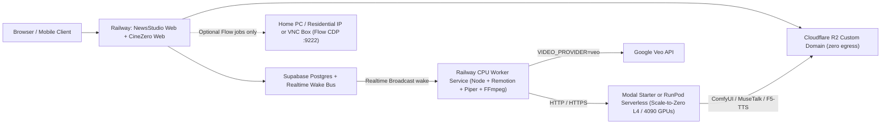

# Cloud Cost Forecast, Custom Domain Caveats & Online Worker Architecture

This guide documents the long-run infrastructure pricing for **Cloudflare R2 + Railway + Supabase**, critical caveats to address before assigning a custom domain, and the recommended online hosting topology for both the **NewsStudio (`:8766`)** and **CineZero (`:8765`)** workers.

---

## 1. Observed Live Baseline (Current Production Footprint)

Measurements below come directly from the live production deployment (`https://newsstudio.up.railway.app`):

| Layer | Current Measured Usage | Free Tier Ceiling | Utilization & Growth Rate |
|---|---|---|---|
| **Supabase Postgres** | **`24 MB`** (`25,261,747` bytes across `39` RLS tables, `10,422` presets, `48` personas, `66` action loops, `15` master poses) | `500 MB` | **`4.8%`** — each new story/script/job adds only `~15–30 KB` (`10,000` stories ≈ `~250 MB`) because binary media lives in R2. |
| **Supabase Realtime** | **`1` WebSocket** (`realtime:newsstudio-worker-wake`) while worker is running; `0` idle messages | `200` concurrent WS, `2M` msgs/mo, `5 GB` egress | **`0.5%` connections**, **`< 0.1%` msgs** (`25s` Phoenix `heartbeat` frames are exempt from message quotas; `0%` DB WAL replication via stateless Broadcast; `< 10 MB/mo` egress with `15m` safety sweeps). |
| **Cloudflare R2** | **`245.63 MB`** across **`433` objects** (includes E-Commerce assets, Studio plates, and `3` flagship action-loop personas: `ruby`, `mateo`, `blaze`) | `10 GB-mo`, `1M` Class A writes, `10M` Class B reads, **\$0 egress** | **`2.46%` storage** (`public/assets/action_loops` kept selective locally on worker disk rather than uploading the full library). |
| **Railway (`newsstudio`)** | **`~182 MB` RSS RAM** (`--max-old-space-size=384`), `sleepApplication: true` | `\$5/mo` Hobby credit (`\$20/vCPU-mo`, `\$10/GB-RAM-mo`, `\$0.05/GB` egress) | Sleeps automatically after ~5–10 min idle; active idle-friendly compute fits comfortably inside the `\$5` Hobby floor. |

---

## 2. Long-Run Monthly Pricing Estimate (Cloudflare R2 + Railway + Supabase)

### Current Published Unit Rates

- **Railway**:
  - **Hobby (`\$5/mo`)**: Includes `\$5/mo` usage credit (minimum spend, not a hard cap); builds are free. Metered usage bills per second at `\$20/vCPU-mo`, `\$10/GB-RAM-mo`, `\$0.15/GB-mo` persistent volume, and **`\$0.05/GB` outbound network egress**.
  - **Pro (`\$20/mo`)**: Includes `\$20/mo` usage credit, team seats, higher scaling limits, and 30-day logs.
  - **Serverless (`sleepApplication: true`)**: Stops CPU/RAM billing after ~5–10 min without outbound traffic, waking on the next request.
- **Cloudflare R2 (Standard Storage)**:
  - **Free tier (monthly)**: `10 GB-month` storage, `1,000,000` Class A ops (`PutObject`, `CopyObject`, `ListObjects`), `10,000,000` Class B ops (`GetObject`, metadata), **unlimited free egress (`\$0.00/GB`)**.
  - **Paid overages**: `\$0.015/GB-mo` storage, `\$4.50` per `1M` Class A ops, `\$0.36` per `1M` Class B ops, **`\$0.00/GB` egress**.
- **Supabase**:
  - **Free (`\$0/mo`)**: `500 MB` DB, `5 GB` origin + `5 GB` cached egress, `200` peak Realtime sockets, `2M` Realtime msgs/mo. **Pauses automatically after 7 days of zero API/DB activity**; no automatic daily backups.
  - **Pro (`\$25/mo`)**: `8 GB` DB, `250 GB` origin + `250 GB` cached egress, 7-day daily backups, no auto-pause, plus `\$10/mo` compute credit (fully covers `1` Micro `\$10/mo` DB instance).

### Projected Monthly Cost by Stage

| Service | Stage 1: Solo Studio (`~50–100` videos/mo, Yr 1, `<= 40 GB` R2) | Stage 2: Growing Archive (`~1,000+` stored videos, `~80 GB` R2) | Stage 3: Multi-User SaaS (`24/7` SLA + daily backups, `~250 GB` R2) |
|---|---|---|---|
| **Railway** *(Web + API)* | **\$5.00 / mo** *(Hobby floor; actual sleeping compute `~\$0.60–\$1.50` covered by the `\$5` credit)* | **\$5.00 / mo** *(stays inside `\$5` credit once R2 serves media off a custom CDN domain — see §3)* | **\$20.00 / mo** *(Pro plan w/ `\$20` credit, team seats, 30-day log history)* |
| **Cloudflare R2** *(Media)* | **\$0.00 – \$0.45 / mo** *(Free under `10 GB`; `40 GB` = `30 × \$0.015` = `\$0.45`)* | **~\$1.05 / mo** *(`70 GB` billable × `\$0.015/GB`; ops well within `10M`/`1M` free caps; `\$0` egress)* | **~\$3.60 / mo** *(`240 GB` billable × `\$0.015/GB`; `\$0` egress)* |
| **Supabase** *(Postgres + Realtime)* | **\$0.00 / mo** *(Free tier: `< 500 MB` DB, `< 5 GB` egress, `< 0.5%` Realtime)* | **\$0.00 / mo** *(or `\$25.00 / mo` if you want daily backups & zero 7-day pause)* | **\$25.00 / mo** *(Pro plan: `8 GB` DB, `250 GB` egress, backups, `\$10` Micro compute included)* |
| **Total Core Infra** | **\$5.00 – \$5.45 / mo** | **~\$6.05 / mo** *(or `\$31.05` w/ Supabase Pro)* | **~\$48.60 / mo** |

---

## 3. Custom Domain Assignment — Critical Cost & Setup Caveats

Follow these 6 rules before pointing a custom domain at Railway and Cloudflare so domain activation does not introduce hidden egress charges, surprise Clerk upgrades, or broken media/auth headers:

### 3.1 Stop Proxying `/r2/*` & `/assets/*` Through Railway (**Biggest Cost Trap**)
Currently, `next.config.ts` (`rewrites()`) and `src/remotion/utils/resolveSrc.ts` route `/r2/:path*`, `/assets/:path*`, `/avatars/:path*`, `/studio_plates/:path*`, and `/studio_environments/:path*` through Next.js on Railway so media loads same-origin under `*.up.railway.app` and `COEP: credentialless`.

- **Why it costs extra at scale**: R2 → Railway transfer is free from Cloudflare, **but Railway bills `\$0.05/GB` for every byte Next.js streams to browsers** (`100 GB` of video playback = `\$5.00`) and wakes/keeps the Railway container busy serving static MP4/PNG ranges.
- **What to do when attaching your domain**:
  1. Attach a dedicated custom domain (e.g., `cdn.yourdomain.com`) directly to your R2 bucket in Cloudflare.
  2. Configure R2 bucket CORS allowing `GET`, `HEAD`, `Range` headers from `https://app.yourdomain.com`, exposing `Content-Range`, `Accept-Ranges`, `Content-Length`, and `ETag` (needed by Remotion `<Player />` seeking and WebAudio/WebGL under COEP).
  3. Set `NEXT_PUBLIC_S3_PUBLIC_URL=https://cdn.yourdomain.com` on Railway.
  4. Update `src/remotion/utils/resolveSrc.ts` to emit direct `https://cdn.yourdomain.com/...` URLs in production and remove/disable the media `rewrites()` in `next.config.ts`. Video streaming egress becomes **`\$0.00/GB`** permanently.

### 3.2 Add Cloudflare Cache Rules & Force SSL **`Full (strict)`**
- **On `cdn.yourdomain.com` (R2 custom domain)**: Without caching or tight origin headers, repeat video previews/thumbs hit R2 directly and count toward R2's `10M/mo` free Class B (`GetObject`) limit (`\$0.36/1M` above free). Create a Cloudflare Cache Rule to cache `/assets/*`, `/avatars/*`, `/studio_plates/*`, and `/studio_environments/*` at the edge with long TTLs.
- **On `app.yourdomain.com` (Railway custom domain)**: If you orange-cloud proxy through Cloudflare, set **SSL/TLS mode to `Full (strict)`** (never `Flexible`, which causes infinite HTTPS→HTTP redirect loops with Railway/HSTS/Clerk) and bypass Cloudflare HTML/API caching on `/api/*` and `/_next/data/*`. Alternatively, leave Cloudflare DNS **gray-cloud (DNS-only)** pointing at Railway's CNAME target.

### 3.3 Rebuild After Changing Any `NEXT_PUBLIC_*` Variable
In `Dockerfile`, `NEXT_PUBLIC_APP_URL`, `NEXT_PUBLIC_CLERK_PUBLISHABLE_KEY`, and `NEXT_PUBLIC_S3_PUBLIC_URL` are injected via `ARG`/`ENV` at `npm run build` time.
- Updating variables in Railway alone is not enough for client bundles/Next.js `rewrites()` — **trigger a redeploy/rebuild** after updating them.
- Also update `MAIN_APP_URL` on any local or cloud worker `.env` files to match your new primary domain (`https://app.yourdomain.com`) so claim/heartbeat/upload callbacks do not hit stale `up.railway.app` URLs.

### 3.4 Clerk Production Keys (`pk_live_` / `sk_live_`) & CSP / Image Allowlists
- Clerk production instances require a verified custom domain (`clerk.yourdomain.com` + `accounts.yourdomain.com`), unlike dev instances (`*.clerk.accounts.dev`).
- Before switching to `pk_live_` / `sk_live_`, update `next.config.ts`:
  - Add your Clerk custom domain (`https://clerk.yourdomain.com`, `https://accounts.yourdomain.com`) and CDN domain (`https://cdn.yourdomain.com`) to `Content-Security-Policy` (`script-src`, `connect-src`, `img-src`, `media-src`, `frame-src`, `form-action`) and `images.remotePatterns`.
- Check Clerk seat limits before inviting external org members: Clerk's Free tier includes up to `10,000` MAUs, whereas advanced B2B organization/custom RBAC thresholds can trigger a `\$25/mo` Clerk Pro tier if exceeded.

### 3.5 Never Point External Uptime Monitors at Sleeping Services
Railway `sleepApplication: true` saves most of your compute bill when idle. External HTTP monitors (UptimeRobot, Better Stack, Pingdom) hitting `/` or `/api/health` every 1–5 minutes prevent Railway from ever sleeping and burn 24/7 compute hours unnecessarily.

### 3.6 Enforce R2 `temp/` Cleanup & Selective Action-Loop Uploads
- In addition to the worker's 7-day `sweepExpiredTempStorage()` routine (`workers/pipeline-worker/index.ts`), add an **R2 Object Lifecycle Rule** on prefix `temp/` to expire objects after `7 days` directly in Cloudflare (zero cost, works even while all workers are stopped).
- Keep `public/assets/action_loops` selective in R2 (flagship personas only, currently `163.83 MB`) so bucket storage remains well below `10 GB`.

---

## 4. How to Host NewsStudio (`:8766`) & CineZero (`:8765`) Workers Online Later

Renting an always-on cloud GPU VM (`\$300–\$700/mo`) is unnecessary because **80%+ of worker wall-clock time** is FFmpeg orchestration, HTTP uploads, Remotion React bundling, and API calls — only short inference bursts require CUDA VRAM.

### 4.1 Hosting the NewsStudio Worker Online (`role: "full"`)
Because `workers/pipeline-worker` already talks to heavy AI servers strictly over HTTP (`MODERN_TTS_SERVER_URL`, `MUSETALK_SERVER_URL`, `COMFYUI_URL`, `OBJECT3D_SERVER_URL`), split it into two tiers:

1. **Always-Deployable CPU Orchestrator on Railway (`~\$0 – \$3/mo` extra)**
   - Run `workers/pipeline-worker` as a second service in your existing Railway project (sleeping/idle between Supabase Realtime wakes, just like the web container).
   - **Runs cleanly with zero GPU**:
     - **Piper ONNX TTS** (CPU inference)
     - **Headless Remotion CLI renders & FFmpeg stitching** (Railway Hobby allows bursting up to `48` vCPUs during a `~60s` render at `~\$0.02/render`, then drops back to idle/sleep)
     - **Gemini LLM & Veo API** calls, plus `sweepExpiredTempStorage` & schedule checks
   - For action-loop sources during cloud Remotion renders, either pull on demand from R2 into `/tmp` (`\$0` R2 egress) or attach a small `10 GB` Railway Volume (`\$1.50/mo`).

2. **Serverless Burst GPUs on Modal or RunPod (`\$0/mo` idle)**
   - Move **MuseTalk / Ditto**, **F5-TTS / CosyVoice / StyleTTS2**, **ComfyUI** (FLUX/PuLID/Wan/LTX), and **Modern-Mesh / Object3D** to scale-to-zero serverless GPU containers:
     - **Modal Starter Plan (`\$0/mo` base + `\$30/mo` free compute credits)**: NVIDIA L4 (`24 GB` VRAM) bills `~\$0.000222/sec` (`~\$0.80/active hr`), so `\$30` free credits cover **`~37.5` pure active GPU hours/month at `\$0`** with GPU memory snapshots for fast cold starts.
     - **RunPod Serverless**: Container-native (bring existing Dockerfiles) with cheap **RTX 4090 (`24 GB`)** pods/workers (`~\$0.34/hr` Community pods to `~\$0.89/hr` Secure / Serverless active runtime).
   - Point `MODERN_TTS_SERVER_URL`, `MUSETALK_SERVER_URL`, and `COMFYUI_URL` on the Railway CPU worker at those HTTPS endpoints.

### 4.2 Hosting the CineZero Worker (`:8765`) Online
CineZero abstracts its video generation backend via `VIDEO_PROVIDER` (`src/server/video`) while performing 24fps normalization, sharpest end-frame selection, audio fades, and hash-reused segment assembly via local `ffmpeg`/`ffprobe`:

1. **Path A — Recommended for Unattended Cloud (`VIDEO_PROVIDER=veo` on Railway, `~\$0 – \$2/mo` compute)**
   - With `VIDEO_PROVIDER=veo`, CineZero needs **zero GPU and zero Chromium** — only Node.js + `ffmpeg`/`ffprobe` + R2.
   - Run it as a lightweight Railway service (with `sleepApplication: true`) waking only when shots are queued. Deterministic HTTP calls, zero browser session expiry, zero bot challenges.

2. **Path B — If You Must Spend Google Flow Web Credits (`VIDEO_PROVIDER=flow`, `~\$4 – \$6/mo`)**
   - Driving Google Flow requires a live logged-in Chrome/Edge session (`--remote-debugging-port=9222`). Running that online requires a small stateful container or VPS (`2 vCPU / 4 GB RAM`, e.g., Hetzner Cloud `~\$4.50/mo` or Railway Volume + `Chromium + KasmVNC` behind **Tailscale** or **Cloudflare Access**) so you can log in interactively when Google cookies expire.
   - **Important operational caveat**: Google aggressively flags datacenter IPs (Railway, AWS, Hetzner) with anti-bot/Turnstile checks on `labs.google/fx`. Never attempt automated CAPTCHA/bot bypasses. In practice, the highest-reliability hybrid setup is **CineZero Veo API on Railway** for anywhere/anytime cloud runs, plus keeping **`Flow` (`:9222`) on a residential IP** (your main workstation when awake, or a tiny low-wattage home mini-PC reachable over Tailscale) when spending Flow credits.

### 4.3 Target Full-Cloud Summary (Excluding AI API Token Usage)
- **Railway Hobby (`\$5/mo` shared pool)**: NewsStudio Web + CineZero Web + NewsStudio CPU/Remotion Worker + CineZero Veo/FFmpeg Worker
- **Cloudflare R2 (`\$0 – \$2/mo`)**: Storage + custom CDN domain (`\$0` egress)
- **Supabase (`\$0 → \$25/mo`)**: Free during solo growth, Pro when daily backups & zero idle-pause are desired
- **Modal Starter (`\$0/mo` within `\$30` credit)**: On-demand L4 GPU inference (`~37.5` GPU hrs/mo free)
- **Estimated Total**: **`~\$5 – \$10/month`** on Free/Starter tiers, scaling to **`~\$35/month`** with Supabase Pro.
