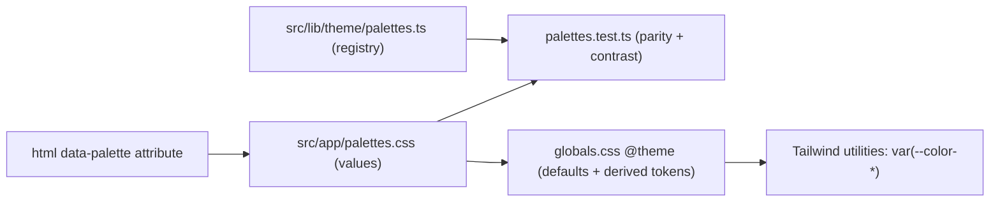

# Theming & Color Palettes

NewsStudio ships several color palettes that can be switched at runtime. All of them are dark themes.

| Palette | id | Accent | Character |
|---|---|---|---|
| Obsidian (default) | `obsidian` | Emerald `#10b981` | The original broadcast look |
| Midnight Newsroom | `midnight` | Azure `#3b9eff` | Navy control room |
| Aurora | `aurora` | Lavender `#a78bfa` | Ink-violet |
| Ember | `ember` | Orange `#fb923c` | Warm charcoal studio |
| Graphite | `graphite` | Silver `#e5e5e5` | Pure monochrome |
| High Contrast | `contrast` | Yellow `#ffd60a` | Accessibility (WCAG AAA text, 3:1 borders) |

## How it works

- **Tailwind v4 is CSS-first.** Utilities like `bg-surface` compile to `background-color: var(--color-surface)`, so overriding the variable on `<html>` re-themes everything with no rebuild and no React re-render.
- **Palettes are attribute-scoped blocks:** `:root[data-palette="midnight"] { --color-accent: … }`. These blocks are unlayered, so they win over Tailwind's `@layer theme` defaults.
- **Only base tokens are set per palette.** Derived tokens (`accent-muted`, `accent-subtle`, `surface-translucent`, `.glass-*`, `::selection`) are built with `color-mix()` in `globals.css` and follow the palette automatically.
- **Hard-coded neutrals are remapped.** Much of the UI uses `zinc-*` / `slate-*` / `gray-*` / `neutral-*` directly. For every palette except Obsidian, those scales are rebuilt in OKLCH from the palette's `--neutral-hue` / `--neutral-chroma`, using Tailwind's zinc lightness steps. Older screens therefore pick up the palette tint without being rewritten.
- **Status colors are fixed.** `success`, `warning`, `error`, `info`, `ruby` and `amber` (and the literal `emerald-*` / `rose-*` / `amber-*` classes) keep the same color in every palette, because they mean something (online, failed, on air).

## Semantic tokens

Prefer these over literal Tailwind colors in new code. Then the component follows whichever palette is active.

| Purpose | Utility examples |
|---|---|
| Canvas / panels | `bg-background`, `bg-surface`, `bg-surface-raised`, `bg-surface-overlay`, `bg-card` |
| Text | `text-foreground`, `text-subtle`, `text-muted`, `text-muted-foreground` |
| Borders | `border-border`, `hover:border-border-hover`, `border-border-subtle` |
| Brand / interactive | `bg-accent`, `text-accent`, `hover:bg-accent-hover`, `bg-accent/15`, `text-accent-foreground` (on a solid accent fill) |
| Status | `text-success`, `text-warning`, `text-error`, `text-info` |

## Adding a palette

1. Add an entry to `PALETTES` in `src/lib/theme/palettes.ts`.
2. Add a matching `:root[data-palette="<id>"]` block to `src/app/palettes.css` that declares every base token, plus `--neutral-hue` / `--neutral-chroma`.
3. Run `npx vitest run src/lib/theme`. The test fails if the registry and the CSS differ, if a token is missing, or if a contrast target is missed:
   - foreground on background / raised surface ≥ 7:1
   - subtle and muted-foreground on background ≥ 4.5:1
   - accent on background, and accent-foreground on accent ≥ 4.5:1

## Known limitations

- **No light palette yet.** About 800 call sites use `text-white` and about 400 use `bg-black/*` overlays. A light theme needs those moved to semantic tokens first.
- Remotion compositions (`src/remotion/`) do not use the palettes. Rendered videos follow brand settings, not the UI theme.
